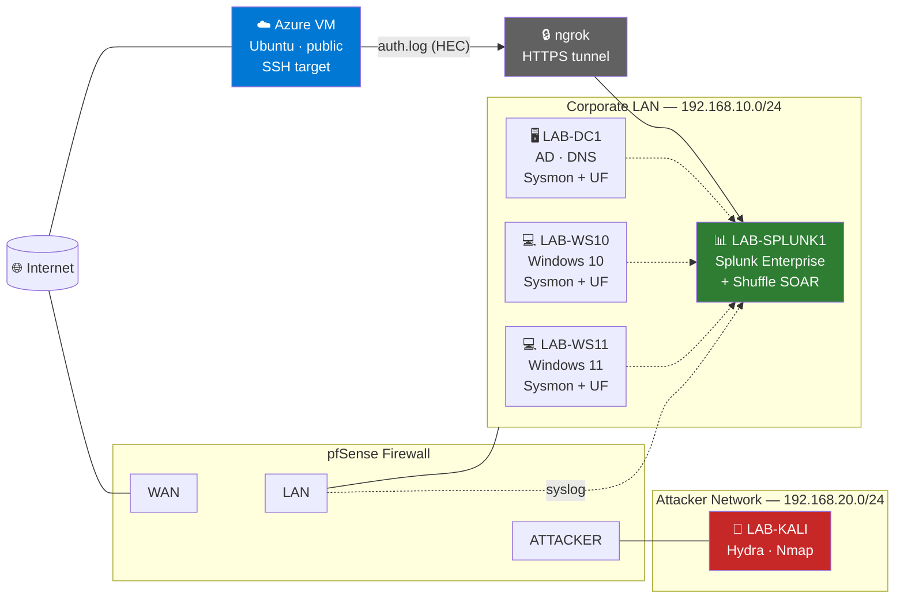

# 🛡️ SOC Home Lab — Enterprise-Style SIEM, Detection Engineering & SOAR Automation


> A fully self-built Security Operations Center lab simulating a realistic enterprise environment: Active Directory, endpoint telemetry, a SIEM pipeline, custom detections mapped to MITRE ATT&CK, threat hunting, hybrid cloud monitoring, and a working SOAR automation layer with human-in-the-loop approvals.

**Author:** Ahmed Mostafa Hussein
**Status:** Actively maintained | Built end-to-end from scratch on a single workstation

---

## 📑 Table of Contents

- [Why This Project Exists](#-why-this-project-exists)
- [Live Demo](#-live-demo)
- [Architecture Overview](#architecture-overview)
- [What's Inside This Repo](#-whats-inside-this-repo)
- [Repository Structure](#-repository-structure)
- [Tech Stack](#-tech-stack)
- [Detection Coverage (MITRE ATT&CK)](#-detection-coverage-mitre-attck)
- [SOAR Automation Highlights](#-soar-automation-highlights)
- [Hybrid Cloud Monitoring](#hybrid-cloud-monitoring)
- [Dashboard](#-dashboard)
- [Threat Hunting](#-threat-hunting)
- [Lab Safety Notes](#lab-safety-notes)
- [Acknowledgements](#-acknowledgements)
- [License](#-license)
- [Contact](#-contact)

---

## 📌 Why This Project Exists

Most "SOC home lab" projects stop at installing Splunk and triggering one brute-force alert. This project goes further: it builds a small but realistic **enterprise network** (domain controller, endpoints, firewall, attacker machine), wires up **real telemetry pipelines**, writes **custom detections** for the attacks actually executed in the lab, performs **manual threat hunting**, extends monitoring into a **hybrid cloud asset (Azure)**, and — critically — closes the loop with a **SOAR platform** that enriches, notifies, and (with analyst approval) remediates automatically.

Every alert in this repo fired because an attack was actually run against the lab. Nothing here is theoretical.

---

## 🎬 Live Demo

A recorded walkthrough of the lab in action:

https://github.com/user-attachments/assets/91c96947-8d95-4789-82cb-275f28695cde

---

<a id="architecture-overview"></a>

## 🏗️ Architecture Overview



**Domain:** `soclab.internal` | **Networks:** VMware Workstation, 3 isolated virtual switches | **Core platform:** Splunk Enterprise (Trial) + Splunk Universal Forwarders

---

## 🧩 What's Inside This Repo

| Folder | Contents |
|---|---|
| [`infrastructure-setup/`](./infrastructure-setup) | Building the network, pfSense, Active Directory, Sysmon, audit policies, and Splunk from scratch |
| [`detections/`](./detections) | 10 custom SPL detections, each mapped to a MITRE ATT&CK technique, each validated against a real attack |
| [`threat-hunting/`](./threat-hunting) | Manual hunts for PowerShell obfuscation, LOLBins, off-hours logons, and lateral movement indicators |
| [`cloud-integration/`](./cloud-integration) | Extending the SIEM to monitor a public-facing Azure VM over a secure tunnel (hybrid monitoring) |
| [`soar-automation/`](./soar-automation) | Self-hosted Shuffle SOAR platform (Docker) — a master playbook that enriches, notifies via Telegram/Email, and blocks IPs on pfSense pending human approval |
| [`dashboards/`](./dashboards) | A seven-panel SOC Detection Overview dashboard: alert volume and severity, MITRE ATT&CK coverage, log-ingestion health, and an SPL-linked triage queue |
| [`architecture/`](./architecture) | Network diagrams and design decisions |

---

## 📁 Repository Structure

```text
SOC-SIEM-SOAR-HomeLab/
├── README.md
├── LICENSE
├── soc-homelab-cover.png
│
├── architecture/
│   └── README.md                       # Data-flow diagrams, layer summary, design decisions
│
├── infrastructure-setup/
│   ├── README.md                       # Build order and rationale
│   ├── 01-network-and-pfsense.md
│   ├── 02-active-directory.md
│   ├── 03-sysmon-and-audit-policy.md
│   ├── 04-splunk-installation.md
│   └── screenshots/
│
├── detections/
│   ├── README.md                       # Detection index, shared alert schema, severity logic
│   ├── 01-… to 10-*.md                 # One write-up per detection (10)
│   └── screenshots/
│
├── threat-hunting/
│   ├── README.md
│   ├── 01-… to 04-*.md                 # One write-up per hunt (4)
│   └── screenshots/
│
├── cloud-integration/
│   ├── README.md
│   ├── 01-azure-vm-deployment.md
│   ├── 02-hybrid-log-forwarding.md
│   └── screenshots/
│
├── soar-automation/
│   ├── README.md
│   ├── 01-soc-master-playbook.md
│   ├── 02-enrich-ip.md
│   ├── 03-enrich-identity.md
│   ├── 04-block-ip-pfsense.md
│   ├── 05-check-telegram-approvals.md
│   └── screenshots/
│
└── dashboards/
    ├── README.md                       # The seven-panel SOC Detection Overview dashboard
    └── screenshots/
```

---

## 🔧 Tech Stack

**SIEM / Data Platform:** Splunk Enterprise 10.6.1.1, Splunk Universal Forwarder, HTTP Event Collector (HEC)
**Infrastructure:** VMware Workstation, pfSense (firewall/router), Windows Server (AD DS, GPO), Windows 10/11 endpoints, Ubuntu Server
**Telemetry:** Sysmon (SwiftOnSecurity config), Windows Advanced Audit Policy, PowerShell Script Block Logging, pfSense filterlog (syslog)
**Offense / Validation:** Kali Linux, Hydra, Nmap
**Cloud:** Microsoft Azure (Azure for Students), ngrok (secure tunneling)
**Automation / SOAR:** Shuffle (self-hosted via Docker Compose), Telegram Bot API, VirusTotal API, AbuseIPDB API
**Frameworks:** MITRE ATT&CK

---

## 🎯 Detection Coverage (MITRE ATT&CK)

| Tactic | Technique | Detection |
|---|---|---|
| Discovery | T1046 — Network Service Discovery | Port Scan Detected (pfSense) |
| Credential Access | T1110.001 — Password Guessing | Brute Force – Multiple Failed Logons (Windows) |
| Credential Access | T1110.001 — Password Guessing | SSH Brute Force Detected (Linux / Azure) |
| Credential Access | T1558.003 — Kerberoasting | Kerberoasting Detected (4769) |
| Credential Access | T1003.001 — LSASS Memory | Credential Dumping – LSASS Access (Sysmon 10) |
| Persistence | T1053.005 — Scheduled Task | Suspicious Scheduled Task Created (4698) |
| Persistence | T1547.001 — Registry Run Keys | Registry Persistence – Run Key Modified |
| Persistence / Priv Esc | T1098 — Account Manipulation | Privileged Group Membership Change |
| Lateral Movement | T1021.001 — Remote Desktop Protocol | RDP Logon Detected (4624 – Type 10) |
| Defense Evasion | T1070.001 — Clear Windows Event Logs | Log Clearing Detected (1102) |

Full detail, SPL query, and validation steps for each detection are in [`detections/`](./detections).

---

## 🤖 SOAR Automation Highlights

This isn't a single webhook-to-Slack demo. The automation layer includes:

- **A central router playbook** ([`SOC-Master-Playbook`](./soar-automation/01-soc-master-playbook.md)) that receives any Splunk alert and routes it to the correct enrichment sub-workflow based on alert type.
- **[IP enrichment](./soar-automation/02-enrich-ip.md)** against VirusTotal and AbuseIPDB, with logic to skip enrichment for private/internal IP ranges.
- **[Human-in-the-loop approval](./soar-automation/05-check-telegram-approvals.md)** via a Telegram bot: high-impact actions (blocking an IP) require an analyst to tap "Block" or "Ignore" before anything is applied.
- **[Real remediation](./soar-automation/04-block-ip-pfsense.md)** — approved blocks are pushed live to a pfSense firewall alias via API, not just logged.
- **Multi-channel notification** — full incident detail by email, condensed real-time alert + action buttons via Telegram.

See [`soar-automation/`](./soar-automation) for workflow diagrams and design notes.

---

<a id="hybrid-cloud-monitoring"></a>

## ☁️ Hybrid Cloud Monitoring

To demonstrate monitoring beyond the local network, the lab extends into Microsoft Azure:

- A public-facing Ubuntu VM was deployed in Azure (Azure for Students subscription).
- Since the lab has no public IP, an **ngrok secure tunnel** exposes the local Splunk HTTP Event Collector to the internet over HTTPS.
- The Azure VM forwards its `auth.log` to Splunk in near real time via a lightweight `systemd` service.
- A dedicated detection (SSH Brute Force – Linux) distinguishes classic brute force from password-spraying based on the diversity of targeted usernames.

Full write-up: [`cloud-integration/`](./cloud-integration) — [VM deployment](./cloud-integration/01-azure-vm-deployment.md) and [hybrid log forwarding](./cloud-integration/02-hybrid-log-forwarding.md)

---

## 📊 Dashboard

A single-pane **SOC Detection Overview** dashboard answers what an analyst asks at the start of a shift:


- Alerts fired per detection, by severity, and over time
- A live MITRE ATT&CK coverage table (tactic → technique → detection → platform)
- **Asset & log ingestion health** — a Silent/Online heartbeat per host, so "no alerts" can be told apart from "no data"
- A recent-alerts **triage queue** exposing the SPL behind each alert

Full walkthrough: [`dashboards/`](./dashboards).

---

## 🔍 Threat Hunting

Beyond automated alerting, four manual hunts were performed to search for activity that wouldn't necessarily trigger a scheduled alert — including one hunt that surfaced a legitimate, unrelated data-integrity issue (a corrupted Sysmon bucket from an earlier abrupt shutdown), investigated and confirmed isolated. See [`threat-hunting/`](./threat-hunting).

---

<a id="lab-safety-notes"></a>

## ⚠️ Lab Safety Notes

- All networks are fully isolated from the host machine and home network (no bridged adapters, DHCP disabled on internal segments).
- Credentials shown in documentation are lab-only and have never been reused elsewhere.
- The Azure VM's SSH access is restricted to a single source IP via NSG rules.
- This repository does not include live API tokens, webhook URLs, or credentials — placeholders are used throughout.

---

## 🙏 Acknowledgements

Built as a self-directed learning project to develop and demonstrate practical SOC Analyst (L1/L2) skills: SIEM administration, detection engineering, threat hunting, and security automation.

---

## 📄 License

This project is released under the [MIT License](./LICENSE).

---

## 📬 Contact

- **LinkedIn:** [ahmedmostafahussein](https://www.linkedin.com/in/ahmedmostafahussein)
- **Email:** [a7medmostafa7777@gmail.com](mailto:a7medmostafa7777@gmail.com)
